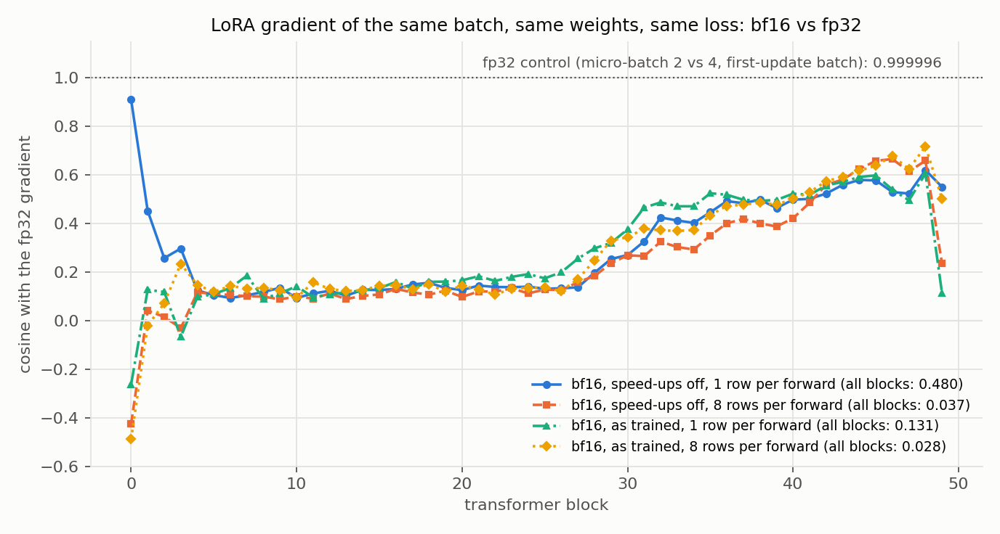
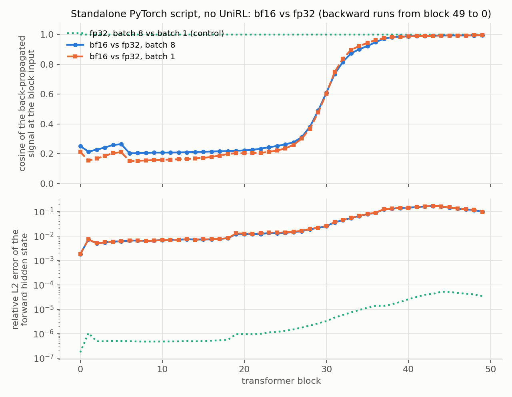
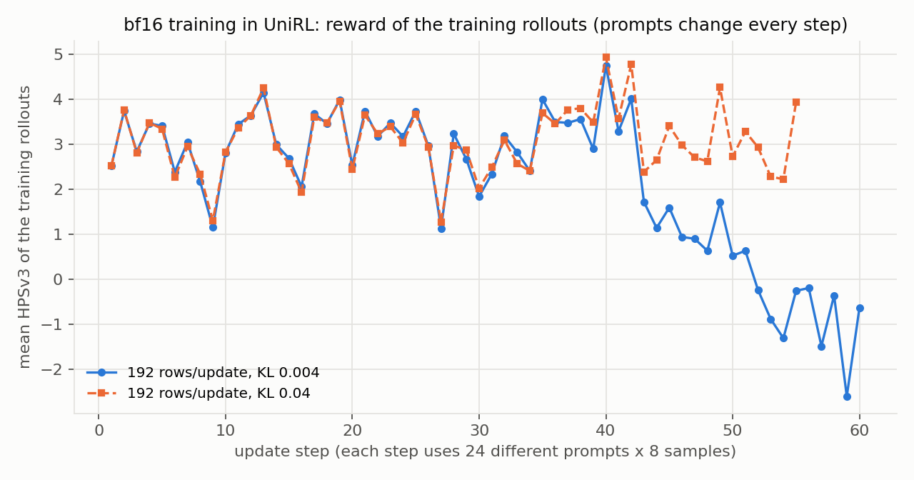
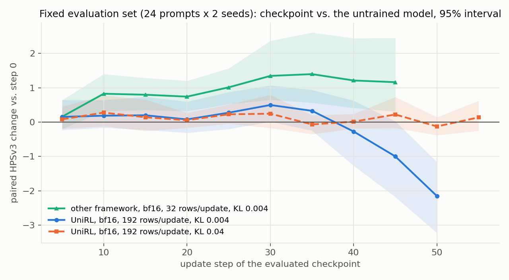

# Results: MiniMax-H3 bf16 vs fp32 LoRA gradient

All numbers come from one host (8 GPUs reporting as `NVIDIA CMP 170HX`, 64 GB each; PyTorch 2.13.0+cu130, diffusers 0.42.1, peft 0.21.2), the step-20 LoRA checkpoint of a bf16 Flash-GRPO run, and one saved batch of 192 rollout rows. Nothing here was reproduced on stock A100s, and there is no fp32 training run to compare the reward curves with.

## 1. LoRA gradient cosine against fp32, per block

Fixed-batch replay, 192 rows. Four bf16 settings: our two speed-ups on ("as trained") or off, 1 or 8 rows per forward. Data: `data/grad_cos_per_block.csv`, `data/grad_cos_overall.csv`; the raw comparison files are in `data/grad_compare_raw/` (`V1` = bf16 as trained, `V2` = bf16 with the speed-ups off, `V3` = fp32; `m1` / `m8` = rows per forward).

| Setting | Cosine vs fp32 | Norm ratio vs fp32 |
|---|---|---|
| bf16, speed-ups off, 1 row per forward | 0.480 | 0.99 |
| bf16, speed-ups off, 8 rows per forward | 0.037 | 0.72 |
| bf16, as trained, 1 row per forward | 0.131 | 0.61 |
| bf16, as trained, 8 rows per forward | 0.028 | 0.76 |

## 2. Standalone script: back-propagated signal per block

Plain PyTorch, no UniRL, one captured micro-batch of 8 rows from one prompt group at sigma = 1.0, same cotangent at the model output in every case. Cosine of the signal entering each block against fp32, and the relative L2 error of the forward hidden state. Data: `data/standalone_backward_cos_per_block.csv`.

## 3. Training reward of the bf16 runs

Mean rollout reward (HPSv3) per update. Data: `data/train_batch_reward.csv`.

## 4. Fixed evaluation set

24 prompts × 2 seeds, 384×256, 10 steps, paired difference against the untrained model with a 95 % interval. Data: `data/eval_paired_delta.csv`.
